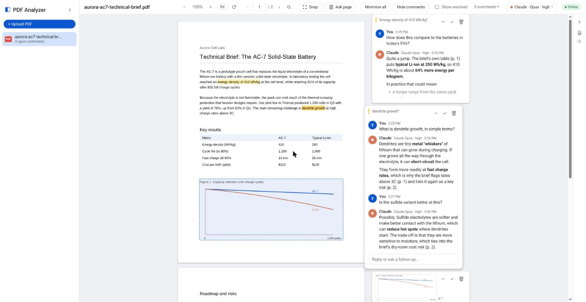
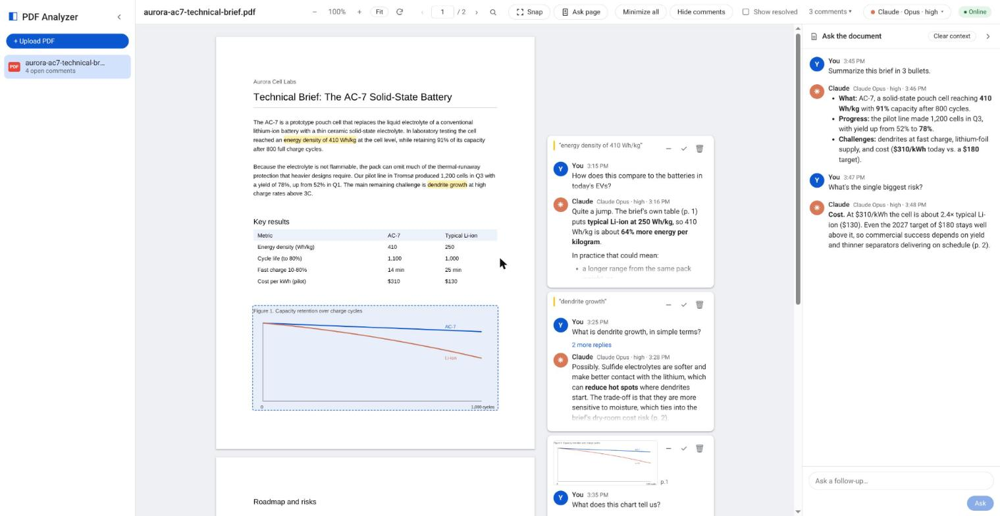
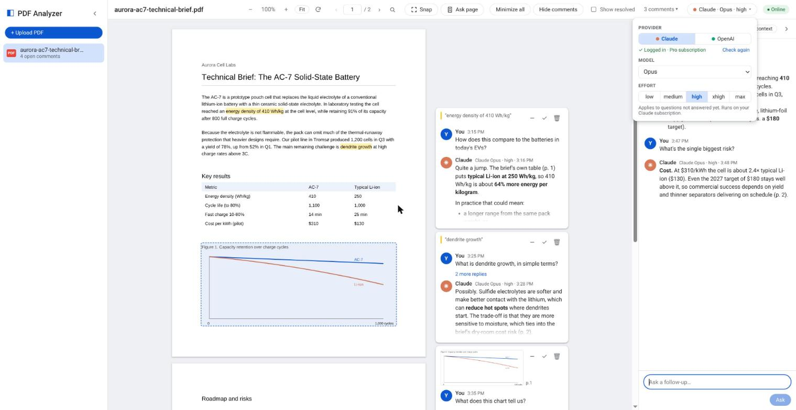
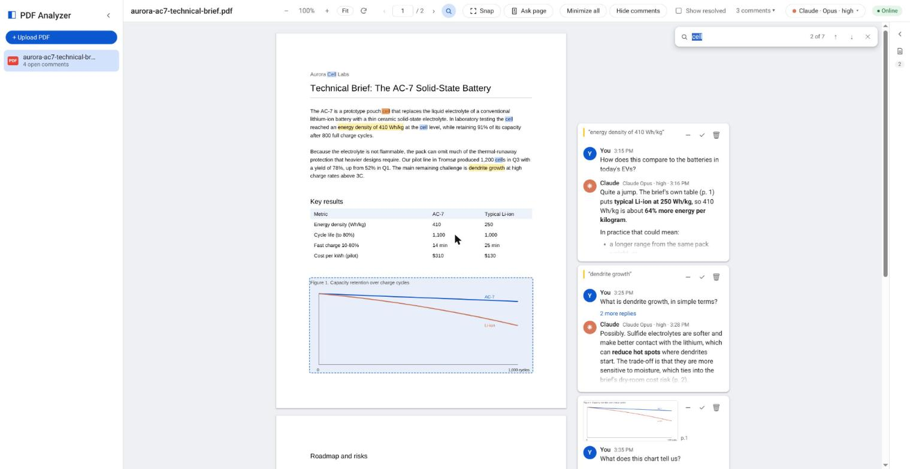

# PDF Analyzer

Upload a PDF, highlight text (or **Snap** a box around any region), and leave a
comment. Claude or OpenAI answers inside the comment thread, Google Docs style.
There's also an **Ask the document** sidebar for questions about the whole PDF.
Everything runs and is stored locally; the only network traffic is to the AI.



| Ask the whole document | Pick the AI, model and effort | Search |
|---|---|---|
|  |  |  |

<sub>Screenshots use a made-up sample document ("Aurora Cell Labs") and sample answers.</sub>

## Prerequisites

- [Nix](https://nixos.org/download) (provides Python, Node, and all packages via `shell.nix`)
- At least one AI CLI installed and logged in on this machine with your subscription:
  - **Claude**: Claude Code: `claude auth login` (check with `claude auth status`)
  - **OpenAI**: Codex CLI: `codex login` → *Sign in with ChatGPT* (check with `codex login status`)

  The server strips `ANTHROPIC_API_KEY`, `ANTHROPIC_AUTH_TOKEN` and `OPENAI_API_KEY`
  from the environment, so answers are billed to your subscriptions, never per API token.

  If a provider isn't logged in, the AI picker marks it **Not logged in** and shows the command
  to fix it. Questions sent to it fail with that same hint and a **Retry** button, so nothing is lost.
  Log in, press **Check again** in the picker, then **Retry**.

## Quick start

```sh
./start
```

`./start` installs Nix if it's missing (it asks for `sudo` once), then starts the backend (`:8000`) and the
frontend dev server (`:5173`, hot reload). Open http://127.0.0.1:5173. `Ctrl+C` stops everything.

| Option | Effect |
|---|---|
| `--prod` | Build the UI once and run a single server on `:8000` |
| `--api-port N`, `--ui-port N` | Use different ports |

The sections below describe running the server by hand.

## Start the server

```sh
nix-shell --run "python3 backend/serve.py"
```

Open <http://127.0.0.1:8000>. On the first run, this installs the frontend's npm
packages and builds the UI inside the nix shell. Later runs start straight away.

Alternatively, enter the shell once and run commands directly:

```sh
nix-shell
python3 backend/serve.py --port 9000 --model sonnet
```

### Flags

| Flag | Default | Description |
|---|---|---|
| `--host HOST` | `127.0.0.1` | Interface to bind. Keep the default so only this machine can reach it. |
| `--port PORT` | `8000` | Port for the UI and API. |
| `--data-dir DIR` | `./data` | Where PDFs, comments and snaps are stored. Can also be set with `PDF_ANALYZER_DATA`. |
| `--workers N` | `3` | Max number of PDFs Claude answers concurrently. Questions on the same PDF are always answered one at a time, in order. |
| `--model NAME` | — | Fallback Claude model when none is selected in the UI (normally unused; pick models in the toolbar). |
| `--build` | off | Rebuild the frontend before starting. Use after changing anything in `frontend/src`. |
| `--reload` | off | Auto-restart the backend when Python files change (development). |

`Ctrl+C` stops the server immediately; open browser tabs are disconnected, and
any answer in progress is re-queued and answered on the next start.

Environment variables (rarely needed): `CODEX_HOME` (Codex config dir, default `~/.codex`); `PDF_ANALYZER_PROBE=host:port` sets the
endpoint used to check whether Claude is reachable (default `api.anthropic.com:443`).

### Frontend development (hot reload)

```sh
nix-shell --run "python3 backend/serve.py --reload"       # terminal 1: API on :8000
nix-shell --run "cd frontend && npm run dev"              # terminal 2: UI on :5173, proxies /api to :8000
```

## Using it

| Action | How |
|---|---|
| Comment on text | Select text and the comment box opens. An empty draft closes when you click away; a draft you've typed into is kept |
| Comment on a region / scanned page | Click **Snap** (or press `S`), drag a box on the page |
| Ask about a whole page | **Ask page**: opens a comment on the page you're viewing, with a picture of the page attached (works on scanned pages) |
| Go to page | Type in the page box (`Ctrl+G` focuses it) and press `Enter`; **‹ ›** step pages |
| Zoom / rotate | **− / +**, **Fit** (fit page width), **⟳** or `R` rotates pages 90°. Both keep your place |
| Search | 🔍 or `Ctrl+F`; `Enter` / `Shift+Enter` for next / previous match, `Esc` closes |
| Jump to a comment | Click **N comments ▾** in the toolbar for a list of all comments. Clicking outside a comment unfocuses it |
| Send | `Enter` (`Shift+Enter` for a new line) |
| Follow-up question | Click a thread, type in **Reply** |
| Stop an answer | **■ Stop** while Claude is writing (or **Cancel** while it's queued) |
| Retry | **Retry** / **Ask again** on a failed or stopped answer |
| Resolve / reopen / delete | ✓ / ↺ / 🗑 on the thread; **Show resolved** toggles resolved threads |
| Cancel draft / exit Snap | `Esc` |
| Ask about the whole PDF | **Ask the document** sidebar on the right (expand it from its strip); **Clear context** starts over and makes the AI forget this PDF's conversation |
| Choose the AI | Toolbar picker: **Claude / OpenAI**, model, effort. Applies to new questions; each answer shows which model wrote it |
| Minimize threads | **–** on a thread, or **Minimize all**; **Hide comments** collapses the comment panel to margin badges |
| Minimize sidebars | **«** on the PDF list, **›** on Ask the document (both collapse to a thin strip) |
| Resolve | ✓ hides the thread; **Show resolved** brings resolved threads back |

Pages with no text layer (flattened or scanned PDFs) show a hint to use Snap.

### Offline behaviour

Every question is written to disk before the server acknowledges it. If Claude
is unreachable, the toolbar shows **Offline — questions queued** and threads show
*"Claude will answer when you're back online"*. The server checks connectivity
every 5 seconds (always, so the toolbar badge flips within ~5 s of losing wifi) and answers the queue in order once Claude is reachable, even after a restart.
If the local server itself is down, the comment stays in the box with a **Retry** button.

## How it works

```
Browser (React + pdf.js) ──HTTP──▶ FastAPI ──▶ data/<file_id>/comments.json (atomic writes)
        ▲                            │
        └────────── SSE ◀── Worker pool ──▶ Claude Agent SDK ──▶ Claude Code (your subscription)
```

- **Providers.** Claude runs through the Claude Agent SDK (Claude Code), with streamed answers.
  OpenAI runs through `codex exec --json` in a read-only sandbox. Codex can't read PDFs directly,
  so the server extracts the text to `document.txt` (with page markers), and snaps are attached as images.
  Codex answers arrive whole, not streamed. Stop works for both.
- **One session per PDF per provider.** On the first question, Claude reads `document.pdf`.
  The session id is saved in `comments.json` and resumed afterwards, so Claude remembers the
  document and every earlier thread on it.
- Claude only has the `Read` tool, restricted to that PDF's own folder.
- Snaps are cropped from a high-resolution render of the page, saved as PNGs, and read by Claude as images.
- Answers stream to the browser over Server-Sent Events. Interrupted answers
  (crash or restart) are put back in the queue on startup.

### Data layout

```
data/<file_id>/
  document.pdf
  document.txt       # extracted text (created on first OpenAI question)
  comments.json      # name, Claude/Codex session ids, threads → messages (+ anchors, agent)
  snaps/<thread_id>.png
```

Anchors are stored as page number + rectangles in page-relative fractions (0–1),
so highlights stay put at any zoom level. Text anchors also store the quoted text.

### API

| Method & path | Purpose |
|---|---|
| `GET /api/files` | List PDFs |
| `PUT /api/files` (multipart `file`) | Upload a PDF → metadata incl. `file_id` |
| `GET /api/files/{id}` | The PDF bytes |
| `DELETE /api/files/{id}` | Delete PDF and all its comments |
| `GET /api/files/{id}/comments` | All threads |
| `POST /api/files/{id}/comments` | New thread `{anchor, text, snap_png?}` (anchor type `text`, `snap` or `doc`) → `202` |
| `POST /api/files/{id}/comments/{tid}/replies` | Follow-up `{text}` → `202` |
| `PATCH /api/files/{id}/comments/{tid}` | `{resolved}` |
| `DELETE /api/files/{id}/comments/{tid}` | Delete thread |
| `POST …/{tid}/messages/{mid}/stop` | Stop / cancel an answer |
| `POST …/{tid}/messages/{mid}/retry` | Re-queue a failed/stopped answer |
| `GET /api/files/{id}/events` | SSE: `status`, `thread`, `thread_deleted`, `delta`, `reset` |
| `POST /api/files/{id}/reset-context` | Clear context: close the whole-document chat, reset AI sessions |
| `GET /api/agents[?refresh=true]` | Providers, login status, models/efforts, current selection |
| `PUT /api/settings` | `{provider, model, effort}`: which AI answers new questions |
| `GET /api/status` | `{online}`: whether the AI is reachable |
